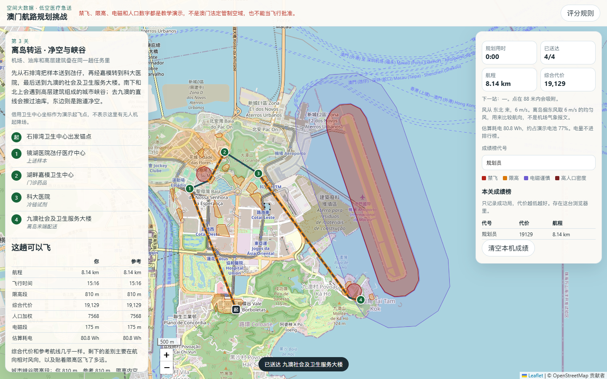
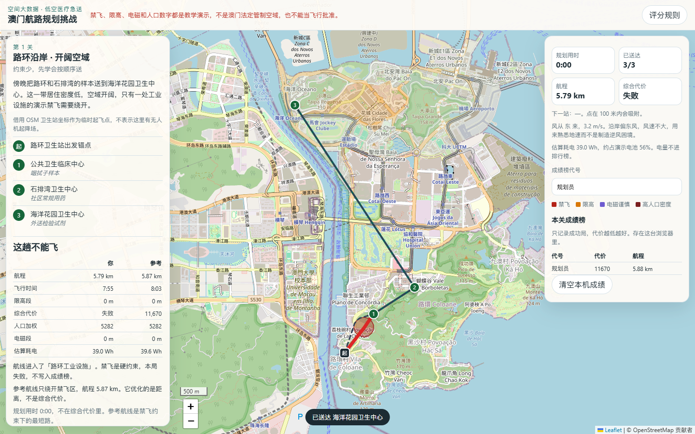
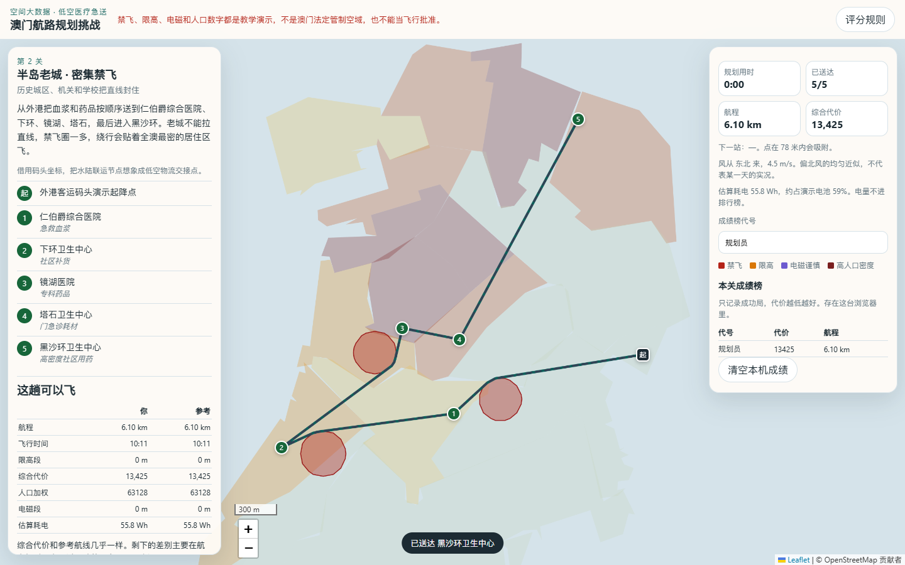

# 澳门低空医疗急送航路规划

把低空物流做成一局可以解释的规划：在澳门演示空域里，按顺序把医疗物资送到卫生站和医院。航线是直线折线，不沿马路。禁飞区一旦进入内部就失败；限高和风改变飞行时间；人口和电磁只负责说明这条路压过了什么样的城区。

禁飞、限高和电磁边界都是教学演示，不是澳门法定管制空域，不能当作飞行批准。



本地打开即可玩。本仓库按 GitHub Pages 的根目录结构准备（`index.html` 在仓库根上），本次没有推送，所以没有公开网址。

## 数据来源

| 数据 | 用在哪里 | 说明 |
| --- | --- | --- |
| OpenStreetMap | 跑道 16/34、医院和卫生站、带 `height` 的建筑 | Overpass 抽取，见 `scripts/fetch_sources.py`。建筑只保留经度 113.536 以东，避免把横琴塔楼算进澳门 |
| 统计暨普查局 2021 人口普查分区 | 长度加权人口密度 | Census GIS 的 `density`（人/平方公里）。服务把坐标标成 wkid 3064，但按这个代码转到 WGS84 会偏到东经 4° 附近；脚本改用 EPSG:8433。边界简化约 32 米 |
| 任务点坐标 | 三关的起降锚点和配送点 | 借用 OSM 兴趣点，不表示那里有无人机起降场 |

全澳 2021 年人口密度约 20,620 人/平方公里（统计暨普查局新闻稿）。路环、石排湾、九澳有一段航线落在这套分区多边形外面，暴露指数会单独标出未覆盖长度，不把空白当成低密度。

若干禁飞圆没有放在兴趣点正中心。兴趣点往往离任务直线有一两百米，圆心若不动，圆要放得很大才会挡住航线，并会吞掉旁边的医院。脚本把圆心挪到「兴趣点向该段直线作垂线的垂足」上，原坐标写在关卡 JSON 的 `source` 里。半径是教学设定。

底图是 OpenStreetMap，经 Leaflet 加载，不需要密钥。

## 复现步骤

```powershell
python -m venv .venv
.\.venv\Scripts\python -m pip install -r requirements.txt
.\.venv\Scripts\python scripts\build_all.py
.\.venv\Scripts\python -m unittest tests.test_planning
node tests/model.test.mjs
.\.venv\Scripts\python -m http.server 8765
```

浏览器打开 `http://127.0.0.1:8765/`。已下载的原始数据在 `data/raw/`，没有网络也能重建关卡。若要重下 OSM 和普查分区，再运行 `python scripts/fetch_sources.py`。

技术栈按指南：前端是原生 HTML/JS 加 Leaflet，不引入框架；基准航线用 Shapely 做几何、NetworkX 做 Dijkstra。航线是直线，所以不用 OSMnx。NumPy 用来算风矢量。多出来的 pyproj 只在数据准备阶段把澳门网格转到 WGS84，游戏运行时只读已经转好的坐标。这样同时保留了可讲解的可视图，和一份能对上真实医院、跑道、人口密度的底图。

## 玩法与规则

点击地图添加途经点，点进下一个配送点约 80–100 米内即送达，必须按顺序。双击地图或按 Enter 提交，Backspace 撤销。规划用时只显示在侧栏，不进综合代价。

| 情况 | 结果 |
| --- | --- |
| 航线进入禁飞区内部（深于约 0.4 米） | 本局失败，不进成绩榜 |
| 只贴着禁飞区边界 | 不算穿越。参考航线会贴边绕行 |
| 穿过限高（城市峡谷） | 该段空速按 7 m/s，区外 12 m/s |
| 风 | 地速 = max(3, 空速 − 逆风分量)，顺风更快 |
| 综合代价 | 航程（米）+ 飞行时间（秒）× 12。无风且无限高时等于航程的 2 倍 |
| 人口暴露、电磁谨慎带、电量 | 只出现在复盘里 |
| 参考航线 | 起降点、配送点和禁飞顶点组成可视图，Dijkstra 求最短路。限高和风不参与寻路 |

三关约束递增：路环沿岸只有一个禁飞圆；半岛老城是三处禁飞（联络办、政府总部、大三巴一带），没有限高；离岛转运叠上跑道净空、油库、学校、18 片由建筑高度聚合的峡谷，以及跑道外侧的电磁谨慎带。成绩榜存在本机 `localStorage`，只保留成功局，代价越低越好。

## 结果与结论

下面是 `python scripts/build_all.py` 生成的参考航线，不是玩家操作。直线指按顺序把任务点直连、不管禁飞。

| 关卡 | 直线 | 参考航线 | 多飞 | 飞行时间 | 限高段 | 综合代价 | 长度加权人口密度 |
| --- | ---: | ---: | ---: | ---: | ---: | ---: | ---: |
| 路环沿岸 | 5.79 km | 5.87 km | 83 m | 8:03 | 0 | 11,670 | 5,282（另有 4.45 km 不在分区内） |
| 半岛老城 | 6.00 km | 6.10 km | 98 m | 10:11 | 0 | 13,425 | 63,128 |
| 离岛转运 | 8.03 km | 8.14 km | 112 m | 15:16 | 810 m | 19,129 | 7,568（另有 5.69 km 不在分区内） |

半岛这一关几乎整段都落在 2021 分区里（未覆盖约 151 米）。长度加权密度 63,128 人/平方公里，大约是全澳均值 20,620 的 3 倍。按长度乘密度，贡献最大的是下环区（76,629 人/平方公里，穿过约 1.16 km），中区穿过的长度也在 1.16 km 左右。最短的绕行仍然贴着高密度老城。

同一条 6.10 km 的半岛航线，若无风，飞行时间约 508 秒；偏北风 4.5 m/s 下是 611 秒。多出来的大约 100 秒来自航向，不是绕路。

离岛参考航线有 810 米在城市峡谷里。限高空速 7 m/s、区外 12 m/s 时，这段大约多 48 秒，折合综合代价约 580。绕路若明显短于这个当量，代价会更低；参考航线故意不优化这一点，用来和「只求最短」对照。它还有约 175 米进入跑道外侧的电磁谨慎带，但不进入跑道禁飞区。按 280 W 估算，这一关参考航线耗电约 81 Wh，占演示电池 105 Wh 的 77%。

前端用同一套公式重算参考航线，与 Python 的综合代价相差在 1% 以内（`tests/model.test.mjs`）。

## 设计理念

这局游戏想说明：地图和游戏都可以是同一套空间约束的界面。禁飞不是贴图，进了就失败；限高不是装饰，它改变地速；人口不是背景色，它告诉你最短路仍然飞过什么样的居住区。可视图加 Dijkstra 是计算几何里的避障最短路，和选址里「在约束下比较可量化的代价」是同一类问题，只是从地面换到了低空。

场景选澳门，是因为配送点、跑道和普查分区都能对上公开数据，也和澳门科技大学的申请场景在同一座城市。任务写成医疗急送，是因为这种任务必须按顺序送达，也必须解释为什么有些空域不能穿。

## 局限与致谢

- 管制空域是演示几何。跑道来自 OSM 中心线外扩约 430 米，不是障碍物限制面；进近面、真实限高和电磁环境都没有使用官方资料。
- 普查分区没有盖住全部路氹填海和路环南岸。威尼斯人一带的坐标会落在分区外，所以路环和九澳航线的人口密度只能解释落在分区内的那一段。
- 建筑高度只来自 OSM 里填了 `height` 的楼。没有高度标签的楼不会进入峡谷层，覆盖不完整。
- 风是每关一个均匀风矢量，用来比较航向，不是机场气象报文。电量是 280 W 加逆风加成的粗算。
- 局部投影以北纬 22.16° 做等距近似，城市尺度上足够比较航程，不是测量级坐标。
- 禁飞圆的圆心经过垂足平移，半径是为了让直线穿过圆而设定的，不能理解成设施的真实安全距离。

数据致谢：OpenStreetMap 贡献者；澳门特别行政区统计暨普查局 2021 人口普查地理信息。底图 © OpenStreetMap 贡献者。Leaflet 1.9.4。





